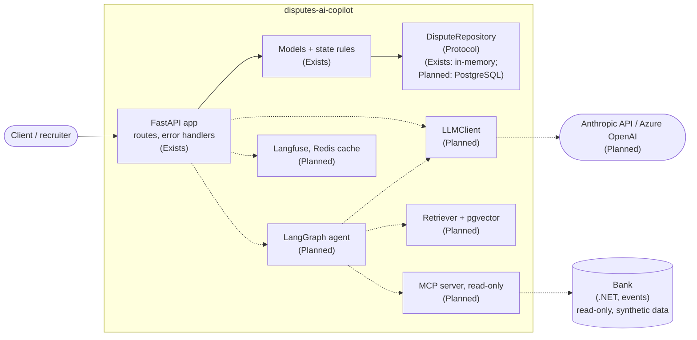

# Architecture

> Status labels: **Exists** = implemented and tested today. **Planned** = decided or intended, not built yet.
> Feature numbers in this document are tentative; Spec Kit assigns the real ones when each feature is specified.

## 1. Purpose

`disputes-ai-copilot` is a FastAPI service for transaction disputes (a customer contests a charge). It is the AI-facing half of a two-part portfolio system:

- **Bank** (separate repository, .NET, event-driven) is the system being operated: transfers, a saga, idempotent handlers, dead-letter queues.
- **Disputes** (this repository) is the copilot that helps operate it: it turns free-text complaints into valid disputes, answers policy questions with cited sources, and reads the state of transfers.

The two are independent. This service never modifies Bank or its database (constitution, principle V). All data is synthetic.

## 2. Component view

Solid lines exist today; dashed lines are planned.

## 3. What exists today

| Piece | File | Notes |
|---|---|---|
| App wiring | `src/disputes/main.py` | Creates the app, registers error handlers and the router, exposes `GET /health` |
| Routes | `src/disputes/routes.py` | `POST /disputes`, `GET /disputes/{id}`, `POST /disputes/{id}/transitions`; the repository is provided through a FastAPI dependency |
| Models | `src/disputes/models.py` | `DisputeCreate` (client input), `Dispute` (stored record, with `updated_at` and `history`), `TransitionRequest` and `StateChange` (one history entry) |
| State rules | `src/disputes/transitions.py` | The only table of allowed transitions and `is_allowed` |
| Repository | `src/disputes/repository.py` | `DisputeRepository` Protocol plus an in-memory implementation; `transition` is an atomic compare-and-set guarded by a `threading.Lock` |
| Errors | `src/disputes/errors.py` | One error envelope for validation errors, not-found, invalid transitions (`409`) and framework HTTP errors |
| Contract | `specs/002-dispute-state-transitions/contracts/` | Current OpenAPI contract (create, get, transition). Feature 001's contract is kept unchanged as the record of that feature. Key parts are checked by tests |

Request flow today: the request is validated by Pydantic at the boundary, the route builds a `Dispute` with system-assigned fields (`id`, `state`, `created_at`, `updated_at`, an empty `history`), and the repository stores it.

Transition flow: the route reads the dispute (`404` if missing), checks `is_allowed` (`409` if not), then calls `repository.transition(id, from_state, to_state, note, at)`. That call changes the dispute only if its state is still `from_state`; otherwise it returns `None` and the route re-reads the dispute and answers `409` saying the state changed. There is no retry.

### Current limits (stated honestly)

- **Storage is in memory.** Data is lost on restart. With more than one worker process, each process has its own memory, so a dispute created in one worker is not visible from another. This is acceptable only until the PostgreSQL feature.
- **Atomic transitions hold inside one process.** The lock in the in-memory repository protects one process; with several workers each has its own memory and lock. PostgreSQL removes this limit.
- **No authentication**, and the referenced transaction is not verified to exist.
- **No AI components yet.**

## 4. Design decisions

| Decision | Why | Status |
|---|---|---|
| `DisputeCreate` (input) separate from `Dispute` (record); input uses `extra="forbid"` | The client may send only what it is allowed to set. Fields such as `state` are assigned by the system, so a client cannot inject them | Exists |
| Repository behind a `Protocol` | Lets PostgreSQL replace the in-memory store without touching the routes | Exists |
| One error format for every error, including those the framework raises (unknown route, wrong method) | Predictable client behavior; covered by tests | Exists |
| Allowed state transitions defined in one place; a closed dispute never reopens | Disputes are a financial process: an invalid or reversible state corrupts the audit trail (constitution II) | Exists |
| Concurrent transitions resolved by an atomic conditional update ("change to X only if the current state is Y"); exactly one wins, the other gets `409 Conflict` | A race on the same dispute must not silently overwrite a final state. In memory this is a lock inside the repository; in PostgreSQL it becomes a conditional `UPDATE` | Exists (in memory) |
| A compare-and-set that fails is refused with `409`, not retried | A retry would hide conflicts and make the result depend on timing; the caller can read the dispute again and decide | Exists |
| Change history embedded in the dispute (`history`), with `updated_at` | One record answers "what changed and when" without a second store; the entries are never edited or removed | Exists |
| `LLMClient` interface with two implementations: Anthropic API and Azure OpenAI | Independence from a single provider; cheap development and evals; tests use a fake with no network | Planned |
| Vector search with `pgvector` inside PostgreSQL | One fewer moving part than a separate vector database | Planned |
| The agent is built once, in LangGraph, with read-only tools (`get_dispute`, `search_policy`) | Keeps scope small | Planned |
| MCP server is read-only and reads Bank's transfer state from synthetic data | Bank stays untouched; the interface is documented and replaceable | Planned |
| Public deployment on Azure Container Apps, scale to zero, with a daily cap on model calls | A live link at near-zero cost | Planned |

## 5. Testing approach

Tests come first (red, then green), as the constitution requires. Model calls are never made in unit tests: the `LLMClient` fake returns fixed answers. Quality of model behavior is measured separately with an evaluation dataset and reported in the README with real numbers.

## 6. Where to find more

- `.specify/memory/constitution.md`: the project principles.
- `specs/`: one folder per feature (spec, plan, tasks, contracts).
- `CLAUDE.md`: current state, roadmap and working rules.
