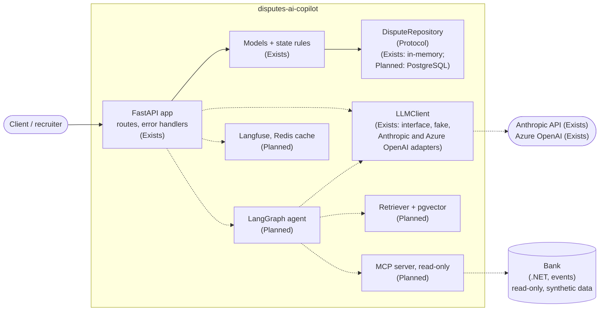

# Architecture

> Status labels: **Exists** = implemented and tested today. **Planned** = decided or intended, not built yet.
> Feature numbers in this document are tentative; Spec Kit assigns the real ones when each feature is specified.

## 1. Purpose

`disputes-ai-copilot` is a FastAPI service for transaction disputes (a customer contests a charge). It is the AI-facing half of a two-part portfolio system:

- **Bank** (separate repository, .NET, event-driven) is the system being operated: transfers, a saga, idempotent handlers, dead-letter queues.
- **Disputes** (this repository) is the copilot that helps operate it: it turns free-text complaints into valid disputes, answers policy questions with cited sources, and reads the state of transfers.

The two are independent. This service never modifies Bank or its database (constitution, principle V). All data is synthetic.

## 2. Component view

Solid lines exist today; dashed lines are planned. The `LLMClient` box exists, but no route, agent or other component calls it yet, so its connections are still dashed.

## 3. What exists today

| Piece | File | Notes |
|---|---|---|
| App wiring | `src/disputes/main.py` | Creates the app, registers error handlers and the router, exposes `GET /health` |
| Routes | `src/disputes/routes.py` | `POST /disputes`, `GET /disputes/{id}`, `POST /disputes/{id}/transitions`; the repository is provided through a FastAPI dependency |
| Models | `src/disputes/models.py` | `DisputeCreate` (client input), `Dispute` (stored record, with `updated_at` and `history`), `TransitionRequest` and `StateChange` (one history entry) |
| State rules | `src/disputes/transitions.py` | The only table of allowed transitions and `is_allowed` |
| Repository | `src/disputes/repository.py` | `DisputeRepository` Protocol plus an in-memory implementation; `transition` is an atomic compare-and-set guarded by a `threading.Lock` |
| Errors | `src/disputes/errors.py` | One error envelope for validation errors, not-found, invalid transitions (`409`) and framework HTTP errors |
| LLM interface and models | `src/disputes/llm/client.py`, `models.py` | `LLMClient` Protocol (`complete`); frozen Pydantic `Message`, `LLMRequest`, `TokenUsage`, `LLMResponse`, `StopReason`; no sampling parameters |
| LLM errors | `src/disputes/llm/errors.py` | `LLMError` and five subclasses, each with a `retryable` class attribute; `LLMConfigurationError`, which is deliberately not an `LLMError` |
| LLM settings | `src/disputes/llm/settings.py` | Anthropic: `ANTHROPIC_API_KEY` (secret), `LLM_MODEL`. Azure OpenAI: `AZURE_OPENAI_BASE_URL`, `AZURE_OPENAI_API_KEY` (secret), `AZURE_OPENAI_DEPLOYMENT`. Both: `LLM_TIMEOUT_SECONDS`. Read on demand, never at import |
| Anthropic adapter | `src/disputes/llm/anthropic_adapter.py` | The only module that imports the provider SDK; one attempt per call (SDK retries off); translates the SDK's errors |
| Azure OpenAI adapter | `src/disputes/llm/azure_openai_adapter.py` | The only module that imports the `openai` SDK; one attempt per call (SDK retries off); sends `max_completion_tokens` and the deployment name; an answer with no text or no usage raises the base `LLMError` |
| Shared behavior tests | `tests/test_llm_contract.py`, `tests/llm_harness.py` | One suite run against the fake and both adapters through a small harness, with no network |
| Fake client | `tests/fake_llm.py` | Test double with scripted answers and failures; lives in `tests/`, not in the shipped package |
| Manual calls and evidence | `scripts/manual_anthropic_call.py`, `scripts/manual_azure_openai_call.py`, `docs/evidence/` | One real call per provider, run by hand and never in CI |
| Contract | `specs/002-dispute-state-transitions/contracts/` | Current OpenAPI contract (create, get, transition). Feature 001's contract is kept unchanged as the record of that feature. Key parts are checked by tests |

Request flow today: the request is validated by Pydantic at the boundary, the route builds a `Dispute` with system-assigned fields (`id`, `state`, `created_at`, `updated_at`, an empty `history`), and the repository stores it.

Transition flow: the route reads the dispute (`404` if missing), checks `is_allowed` (`409` if not), then calls `repository.transition(id, from_state, to_state, note, at)`. That call changes the dispute only if its state is still `from_state`; otherwise it returns `None` and the route re-reads the dispute and answers `409` saying the state changed. There is no retry.

### Current limits (stated honestly)

- **Storage is in memory.** Data is lost on restart. With more than one worker process, each process has its own memory, so a dispute created in one worker is not visible from another. This is acceptable only until the PostgreSQL feature.
- **Atomic transitions hold inside one process.** The lock in the in-memory repository protects one process; with several workers each has its own memory and lock. PostgreSQL removes this limit.
- **No authentication**, and the referenced transaction is not verified to exist.
- **No endpoint uses the LLM client yet.** The client and its two adapters exist and each was exercised by one manual call; there is no AI behavior in the API. The adapters differ in one case: for an answer with no text, Anthropic returns empty text and Azure OpenAI raises `LLMError`.

## 4. Design decisions

| Decision | Why | Status |
|---|---|---|
| `DisputeCreate` (input) separate from `Dispute` (record); input uses `extra="forbid"` | The client may send only what it is allowed to set. Fields such as `state` are assigned by the system, so a client cannot inject them | Exists |
| Repository behind a `Protocol` | Lets PostgreSQL replace the in-memory store without touching the routes | Exists |
| One error format for every error, including those the framework raises (unknown route, wrong method) | Predictable client behavior; covered by tests | Exists |
| Allowed state transitions defined in one place; a closed dispute never reopens | Disputes are a financial process: an invalid or reversible state corrupts the audit trail (constitution II) | Exists |
| Concurrent transitions resolved by an atomic conditional update ("change to X only if the current state is Y"); exactly one wins, the other gets `409 Conflict` | A race on the same dispute must not silently overwrite a final state. In memory this is a lock inside the repository; in PostgreSQL it becomes a conditional `UPDATE` | Exists (in memory) |
| A compare-and-set that fails is refused with `409`, not retried | A retry would hide conflicts and make the result depend on timing; the caller can read the dispute again and decide | Exists |
| Change history embedded in the dispute (`history`), with `updated_at` | One record answers "what changed and when" without a second store; the entries are never edited or removed | Exists |
| Container image built in two stages, non-root, one uvicorn process; CI builds it and smoke-tests `/health` | A reproducible artifact (`uv sync --locked`) with no build tools or dev dependencies in the final stage. One process because the in-memory store and its lock are per process | Exists (not pushed to a registry) |
| `LLMClient` interface with one implementation per provider | Independence from a single provider; tests use a fake with no network | Exists (interface, fake, Anthropic and Azure OpenAI adapters) |
| The adapter makes one attempt per call; failures carry a `retryable` flag; retries and backoff are a later, deliberate feature | A hidden retry (the SDK's default) would multiply calls and cost without anyone deciding it. The flag lets a retry layer be added without changing the errors or the adapter | Exists (flag, no retry) |
| The API key is a `SecretStr`; the service builds its own error messages and raises them after the `except` block | The provider's exception holds the outgoing request, key included. Raising outside the block leaves neither `__cause__` nor `__context__` pointing at it | Exists |
| Settings are built when the adapter is built, not at import; a missing key names the variable | Importing the package must work without a key, and the failure must say what to fix | Exists |
| Vector search with `pgvector` inside PostgreSQL | One fewer moving part than a separate vector database | Planned |
| The agent is built once, in LangGraph, with read-only tools (`get_dispute`, `search_policy`) | Keeps scope small | Planned |
| MCP server is read-only and reads Bank's transfer state from synthetic data | Bank stays untouched; the interface is documented and replaceable | Planned |
| Public deployment on Azure Container Apps, scale to zero, with a daily cap on model calls | A live link at near-zero cost | Planned |

## 5. Testing approach

Tests come first (red, then green), as the constitution requires. Model calls are never made in unit tests: the `LLMClient` fake returns fixed answers, the adapter is tested with the real SDK against an in-memory HTTP transport, and an autouse guard in `tests/conftest.py` fails any test that opens a connection to a non-local host. One real call is documented by hand in `docs/evidence/` and is not run in CI. Quality of model behavior is measured separately with an evaluation dataset and reported in the README with real numbers.

## 6. Where to find more

- `.specify/memory/constitution.md`: the project principles.
- `specs/`: one folder per feature (spec, plan, tasks, contracts).
- `CLAUDE.md`: current state, roadmap and working rules.
