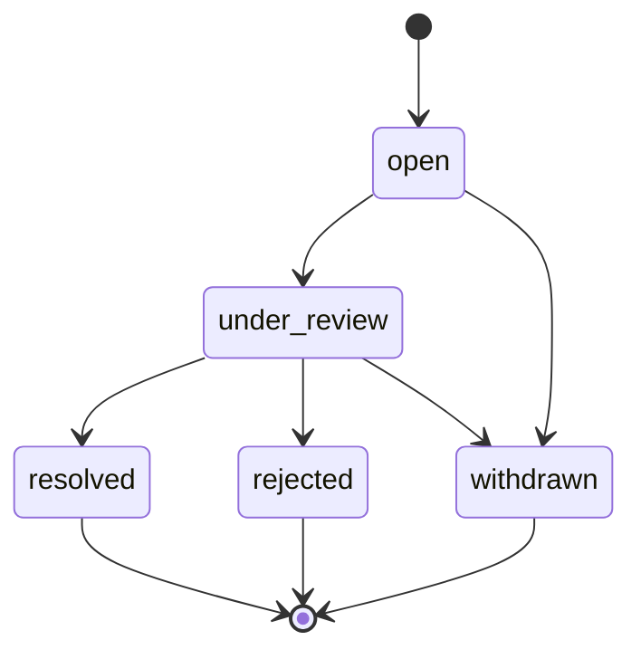

# Data Model: Dispute State Transitions

Changes on top of [feature 001's model](../001-create-and-get-dispute/data-model.md).

## Enums

**Reason** (`str` enum): `duplicate_charge`, `unrecognized_charge`, `product_not_received`,
`incorrect_amount`, `refund_not_received`. (`devolution` is removed; FR-016.)

**DisputeState** (`str` enum): `open`, `under_review`, `resolved`, `rejected`, `withdrawn`.
`resolved`, `rejected` and `withdrawn` are terminal.

## Transition rules (`transitions.py`)

| From \ To | open | under_review | resolved | rejected | withdrawn |
|-----------|:----:|:------------:|:--------:|:--------:|:---------:|
| open | no | **yes** | no | no | **yes** |
| under_review | no | no | **yes** | **yes** | **yes** |
| resolved | no | no | no | no | no |
| rejected | no | no | no | no | no |
| withdrawn | no | no | no | no | no |

5 allowed pairs, 20 refused (FR-002, FR-003, SC-002). A transition to the current state is
refused. This table is the only source of truth; the code holds it as
`ALLOWED_TRANSITIONS: dict[DisputeState, frozenset[DisputeState]]`.



## TransitionRequest (request model)

| Field | Type | Rules | Spec |
|-------|------|-------|------|
| to_state | DisputeState | required, must be one of the five values (case-sensitive) | FR-005, FR-008 |
| note | string or null | optional, at most 1000 characters as sent; empty or whitespace-only becomes null | Assumptions |

Model config: unknown fields are forbidden, so a body with `from_state`, `updated_at`, `state` or
anything else is rejected (FR-010).

## StateChange (history entry)

| Field | Type | Rules | Spec |
|-------|------|-------|------|
| from_state | DisputeState | the state before the change | FR-012 |
| to_state | DisputeState | the state after the change | FR-012 |
| note | string or null | as sent in the request, or null | FR-012 |
| changed_at | datetime (UTC, timezone-aware) | equal to the dispute's `updated_at` right after the change | FR-012, SC-006 |

## Dispute (stored and response model)

All fields from feature 001, with these changes:

| Field | Type | Rules | Spec |
|-------|------|-------|------|
| state | DisputeState | `open` at creation; changed only by a successful transition | FR-001, FR-006 |
| updated_at | datetime (UTC, timezone-aware) | equals `created_at` at creation; set to the time of each successful transition | FR-011 |
| history | list of StateChange | empty at creation; one entry appended per successful transition, oldest first; never edited or removed | FR-012, FR-013 |

Invariant (tested): if `history` is not empty, the first entry's `from_state` is `open`, each
entry's `from_state` equals the previous entry's `to_state`, the last entry's `to_state` equals
`state`, the last entry's `changed_at` equals `updated_at`, and `changed_at` values never
decrease from one entry to the next (nor from `created_at` to the first entry).

`state`, `updated_at` and `history` are always present in responses, so they are marked required
in the generated OpenAPI schema.

## Repository interface

```text
DisputeRepository
├── add(dispute: Dispute) -> None
├── get(dispute_id: UUID) -> Dispute | None
└── transition(dispute_id: UUID, from_state: DisputeState, to_state: DisputeState,
               note: str | None, at: datetime) -> Dispute | None     # new
```

`transition` is atomic: it applies the change only if the dispute exists and its state is still
`from_state`, and then returns the updated dispute (new state, history with one more entry).
`updated_at` and the new entry's `changed_at` both get `max(at, current updated_at)`, computed
inside the same atomic step, so time never goes backwards even if two requests read the clock
in a different order than they are applied (research.md section 6). In any other case it changes
nothing and returns `None`. Callers must not assume the reason for `None`; the route re-reads
the dispute to build the error.

`InMemoryDisputeRepository` keeps its public `disputes` dict and adds a `threading.Lock` held
during the check and the write inside `transition` (and during `add`). It replaces the stored
`Dispute` with a new object rather than mutating the old one, so a dispute already returned to a
caller never changes underneath it.

## Errors

| Situation | HTTP | code |
|-----------|------|------|
| Invalid body (unknown `to_state`, missing `to_state`, unknown field, note too long, malformed JSON), or malformed id in the path | 422 | `validation_error` |
| Well-formed id with no dispute | 404 | `not_found` |
| Transition not allowed from the current state, including to the same state and a lost race | 409 | `invalid_transition` |
| Method not supported on a route (for example `GET /disputes/{id}/transitions`) | 405 | `method_not_allowed` |

Order of checks: the framework validates path and body first (`422`); then the route looks up the
dispute (`404`); then it applies the rules (`409`). Body shape is defined in
[contracts/disputes.openapi.yaml](contracts/disputes.openapi.yaml).
